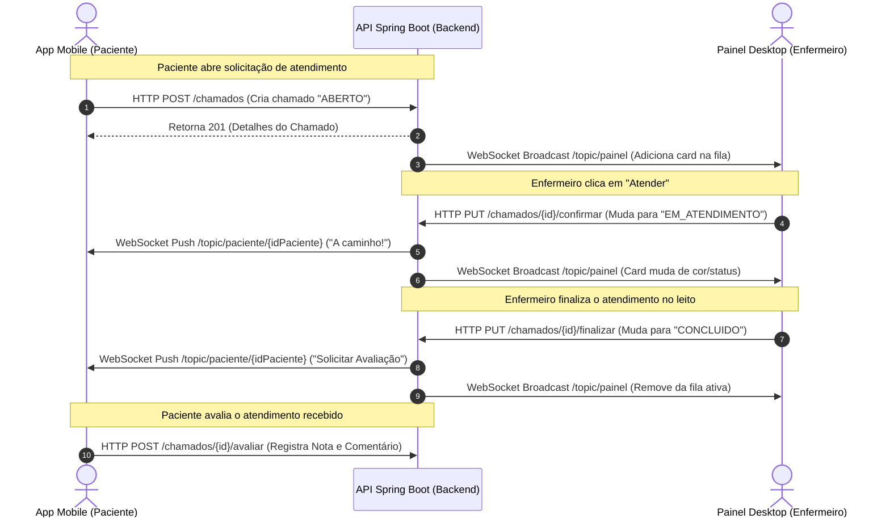

# 🏥 Ecossistema AppCuidar+ (Hospital Cuidar+)

O **AppCuidar+** é uma solução digital hospitalar integrada, projetada para otimizar e gerenciar solicitações de atendimento a pacientes internados em leitos em tempo real. A plataforma reduz o tempo de resposta das equipes assistenciais (enfermeiros, limpeza, nutrição) e fornece dashboards estatísticos para a gestão do hospital.

O ecossistema é composto por três componentes principais:
1. **API Backend**: Desenvolvida em **Java (Spring Boot)**, responsável pela lógica de negócios, segurança e broker de mensagens WebSocket.
2. **Aplicativo Mobile (Paciente)**: Desenvolvido em **React Native (Expo)**, utilizado pelos pacientes nos leitos para solicitar serviços e avaliar atendimentos.
3. **Painel Desktop/Web (Profissional de Saúde)**: Desenvolvido em **React (Vite)**, utilizado nos computadores das alas hospitalares para acompanhar e gerenciar a fila de chamados em tempo real.

---

## 🚀 Fluxo de Tempo Real (Ciclo de Vida do Chamado)

O sistema utiliza a tecnologia **WebSocket (protocolo STOMP)** para permitir que a equipe assistencial e os pacientes estejam em sintonia instantânea, sem necessidade de atualizar a página (*polling*).



---

## 📂 Estrutura do Projeto

O repositório principal está estruturado da seguinte forma:

```text
hospital_app/
├── api/                   # Backend Java (Spring Boot)
├── Cuidar_Plus_v2/        # Frontend Mobile (React Native + Expo)
└── cuidar-plus-desktop/   # Frontend Desktop/Web (React + Vite)
```

### 1. Backend (`/api`)
Projeto Maven em Java 21 baseado na arquitetura em camadas padrão do Spring Boot.

* **`/src/main/java/com/hospital/api/`**
  * **`controller/`**: Endpoints REST expostos pelo Spring MVC (`ChamadoController`, `PacienteController`, `TriagemController`, `AuthController` etc.).
  * **`dto/`**: Objetos de Transferência de Dados (DTOs) usando Java Records para imutabilidade e validações declarativas.
  * **`entity/`**: Entidades mapeadas para o banco de dados PostgreSQL via Hibernate/JPA (`Chamado`, `Paciente`, `Leito`, `Usuario` etc.).
  * **`enums/`**: Definições enumeradas de status (`StatusChamado`: *ABERTO*, *EM_ATENDIMENTO*, *CONCLUIDO*) e categorias.
  * **`infra/`**: Configurações transversais do sistema.
    * `cors/`: Permissões de comunicação entre origens (permitindo requisições do App e Desktop).
    * `security/`: Filtros de autenticação stateless via tokens JWT e criptografia de senhas.
    * `websocket/`: Configuração do Message Broker STOMP.
    * `seeder/`: Preenchimento inicial de banco de dados para testes rápidos.
  * **`repository/`**: Interfaces que estendem `JpaRepository` para comunicação direta com a base de dados SQL.
  * **`service/`**: Classes de regras de negócio de alto nível (`ChamadoService`, `RecuperacaoSenhaService`, `NotificacaoService`).

### 2. Frontend Mobile (`/Cuidar_Plus_v2`)
Desenvolvido em **TypeScript** e **React Native (Expo)**, estruturado seguindo o padrão **MVVM** (Model-View-ViewModel) para máxima separação de interesses.

* **`/src/`**
  * **`models/`**: Definição de tipos e interfaces de dados do domínio (`AuthTypes.ts`).
  * **`context/`**: Provedor global de estado usando React Context API (`AuthContext`), gerenciando a sessão do usuário, controle do token JWT no dispositivo físico e inscrições WebSocket ativas.
  * **`services/`**: Camada de conexão externa via Axios (`authService.ts`).
  * **`viewmodels/`**: Lógicas de estado associadas às telas, lidando com chamadas de API, filtros e tratamentos de erros.
  * **`screens/`** (Views):
    * `LoginScreen`: Tela de entrada para CPF e senha temporária.
    * `EsqueciSenhaScreen`: Fluxo de reset de senha (geração de código de 6 dígitos via e-mail e cadastro de nova senha).
    * `HomeScreen`: Central do paciente, contendo atalhos rápidos e serviços categorizados.
    * `SelecaoAtendimentoScreen` & `CategoriaDetalhesScreen`: Fluxo para escolher um serviço (nutrição, limpeza, enfermagem) e inserir observações.
    * `SolicitacoesScreen`: Acompanhamento dinâmico de chamados ativos e histórico de 24h com opção de avaliação (estrelas + comentário).
    * `PerfilScreen`: Atualização de informações de contato do paciente e de seu acompanhante responsável.
  * **`navigation/`**: Centralizadores de rotas nativas usando Stack Navigation e Bottom Tab Navigation.

### 3. Frontend Desktop (`/cuidar-plus-desktop`)
Desenvolvido com **React**, **TypeScript** e **Vite**, projetado para rodar em computadores de postos de enfermagem.

* **`/src/`**
  * **`pages/`**:
    * `LoginPage`: Login dos profissionais de saúde.
    * `DashboardPage`: Gráficos dinâmicos de performance, tempo médio de atendimento, ranking de categorias e índice de satisfação dos leitos (usando a biblioteca Recharts).
    * `AtendimentosPage`: Painel principal de chamados ativos que escuta alterações via WebSockets. Permite o início rápido do atendimento e o encerramento do chamado com a descrição da resolução.
    * `TriagemPage`: Gestão do fluxo de entrada de pacientes para triagem preliminar no pronto-socorro.
    * `MeuPerfilPage`: Dados cadastrais e perfil da equipe.
  * **`hooks/`**: Custom hooks encapsulando lógica, incluindo `useWebSocket` para centralizar a conexão com a API via cliente SockJS/STOMP.
  * **`services/`**: Configuração central del cliente Axios (`api.ts`).

---

## 🛠️ Tecnologias e Dependências

| Módulo | Tecnologia | Bibliotecas Principais |
| :--- | :--- | :--- |
| **Backend** | Java 21, Spring Boot 4.0.5 | Spring Security (JWT Auth0), JPA/Hibernate, PostgreSQL, WebSockets (STOMP), Springdoc OpenAPI (Swagger) |
| **Mobile** | React Native, Expo SDK 54 | React Navigation, Axios, AsyncStorage, Vector Icons, Keyboard Aware ScrollView, Masked Text |
| **Desktop** | React 19, Vite 8, TypeScript | React Router DOM, StompJS, SockJS-Client, Recharts (Gráficos), Axios |

---

## 🔗 Configuração Local e Conectividade

Recentemente, as configurações do aplicativo mobile foram atualizadas para permitir a conexão direta em uma rede local sem fio (Wi-Fi). 

### O que foi feito e por quê:
Como emuladores e dispositivos físicos móveis se comportam de maneira isolada do `localhost` do seu computador, é necessário apontar a API para o endereço IP local do computador (máquina servidora) na rede privada.

1. O IP da máquina de desenvolvimento na rede local foi identificado como **`10.65.183.50`**.
2. Foi efetuada a substituição do IP antigo (`192.168.15.186`) nos seguintes arquivos do aplicativo Expo (`Cuidar_Plus_v2`):
   * **`app.json`** na propriedade `expo.extra.apiUrl`
   * **`src/services/authService.ts`** na constante `API_BASE_URL`
3. A URL da API para o aplicativo mobile passou a apontar para **`http://10.65.183.50:8080`**, permitindo que o celular físico conectado na mesma rede Wi-Fi consuma a API e os canais WebSockets.

---

## 🏃 Como Rodar o Projeto Localmente

### 1. Pré-requisitos
* Java JDK 21+ instalado e configurado na máquina.
* Node.js (v18+) instalado.
* Banco de dados PostgreSQL configurado.

### 2. Configurando o Banco de Dados e Rodando a API
1. Crie uma base de dados no PostgreSQL (por padrão, as configurações em `api/src/main/resources/application.properties` apontam para o nome `cuidar_plus` ou equivalente).
2. Configure o arquivo `application.properties` com as credenciais locais (`spring.datasource.username` e `spring.datasource.password`).
3. Entre na pasta `api` e execute o comando para inicializar o Spring Boot:
   ```bash
   ./mvnw spring-boot:run
   ```
4. A API estará de pé na porta `8080` (Acesse o Swagger em `http://localhost:8080/swagger-ui/index.html` para consultar a documentação de endpoints).

### 3. Rodando o Aplicativo Desktop/Web
1. Entre na pasta `cuidar-plus-desktop`.
2. Instale as dependências:
   ```bash
   npm install
   ```
3. Inicialize o servidor local do Vite:
   ```bash
   npm run dev
   ```
4. Abra o painel no navegador na porta indicada (normalmente `http://localhost:5173`).

### 4. Rodando o Aplicativo Mobile (Expo)
1. Entre na pasta `Cuidar_Plus_v2`.
2. Instale as dependências:
   ```bash
   npm install
   ```
3. Inicie o servidor do Expo:
   ```bash
   npm run start
   ```
4. Escaneie o QR Code gerado no terminal usando o aplicativo **Expo Go** no seu celular físico (verifique se o seu celular está conectado na mesma rede Wi-Fi com o IP `10.65.183.50`).
